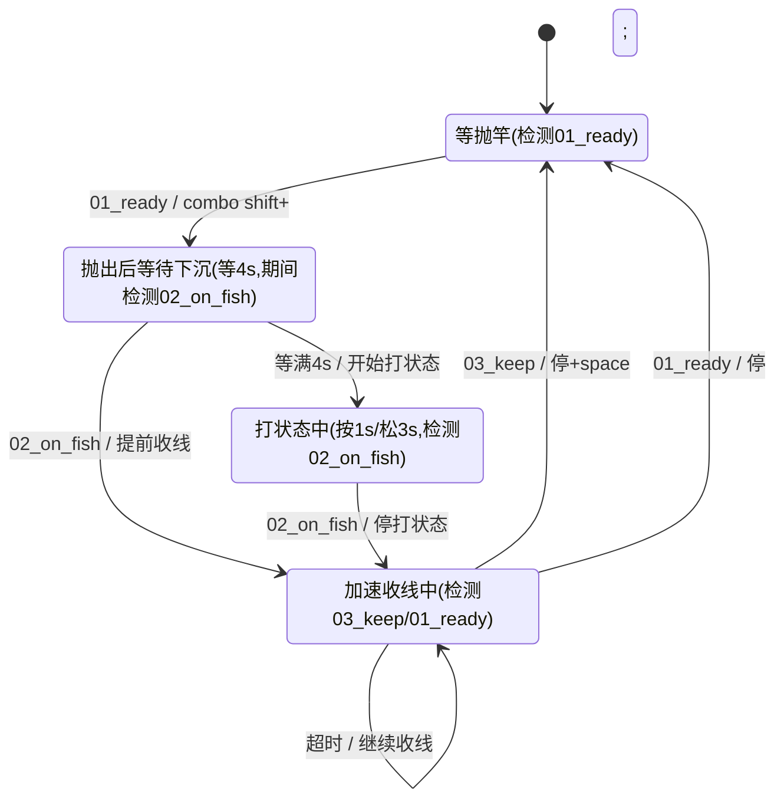

# RF4 路亚直收钓鱼脚本（rf4_lure）

图像检测驱动 ESP32 BLE 键盘，自动完成抛竿 → 打状态 → 加速收线 → 入户的循环。

## 需求

单条鱼的处理流程：

1. `shift + ;` 抛出
2. 等待 4s（可配置 `cast_wait_ms`）
3. 开始打状态：`;` 按 1s 松 3s（可配置）
4. `02_on_fish` 上鱼开始加速收线
5. `03_keep` 入户
6. `01_ready` 重新开始

## 状态机

### 状态说明

| 状态 | 含义 |
|------|------|
| `WAIT_READY` | 等待抛竿准备 |
| `WAIT_SINK` | 抛出后等待下沉（可提前上鱼） |
| `JIGGING` | 打状态中（`;` 按/松循环），等待上鱼 |
| `REELING_FISH` | 中鱼加速收线中（长按 `shift`+`;`+`'`） |
| `STOPPED` | 停止 |

### 状态跳转表（检测频率 0.5s）

| # | 当前状态 | 事件 | 动作 | 目标状态 |
|---|---------|------|------|---------|
| T1 | WAIT_READY | `01_ready` 出现 | combo `shift`+`;` 抛出 | WAIT_SINK |
| T2 | WAIT_SINK | 等满 `cast_wait_ms`（默认 4s） | 开始打状态 | JIGGING |
| T3 | WAIT_SINK | `02_on_fish` 出现（下沉中提前上鱼） | 开始加速收线 | REELING_FISH |
| T4 | JIGGING | `02_on_fish` 出现 | 停打状态 | REELING_FISH |
| T5 | REELING_FISH | `03_keep` 出现 | 停 `shift`+`;`+`'` + tap 空格 | WAIT_READY |
| T6 | REELING_FISH | `01_ready` 出现 | 停 `shift`+`;`+`'`（收完） | WAIT_READY |
| T7 | REELING_FISH | 超时（长按按满无事件） | 停 `shift`+`;`+`'` → 继续收线 | REELING_FISH |

### 状态图



### 各状态检测图片集（0.5s 轮询）

| 状态 | 检测图片 |
|------|---------|
| WAIT_READY | `01_ready` |
| WAIT_SINK | `02_on_fish` |
| JIGGING | `02_on_fish` |
| REELING_FISH（长按中） | `03_keep`、`01_ready` |

检测频率 0.5s（`config.detect_interval_ms: 500`，可配置）。长按中断轮询与主循环一致，均 0.5s。

## 运行

```bash
python -m src.main run docs/examples/04_rf4/rf4_lure.yaml
```

## 快捷键控制

| 快捷键 | 功能 |
|--------|------|
| `ctrl+alt+o` | 启动自动化（从 WAIT_READY 开始） |
| `ctrl+alt+p` | 停止（暂停回空闲，可再启动；长按收线/打状态中立即释放按键） |
| `ctrl+c` | 优雅退出整个脚本（释放按键、关连接） |

- 脚本启动后先空闲等待，按 `ctrl+alt+o` 开始自动钓鱼
- 按 `ctrl+alt+p` 立即停止（含收线长按中途，自动 `release_all` 防卡键），回到空闲
- 再按 `ctrl+alt+o` 从 `WAIT_READY` 重新开始

## 日志格式

状态变化时打印：`[当前状态] | 事件 | 动作 | 目标状态`，检测命中同时打印位置与置信度。

```
[WAIT_READY] | 01_ready (700, 1500) conf=0.912 -> combo shift+; 抛出 -> WAIT_SINK
[WAIT_SINK] | 等满4000ms -> 开始打状态 -> JIGGING
[JIGGING] | 02_on_fish (480, 320) conf=0.885 -> 停打状态 -> REELING_FISH
[REELING_FISH] | 按满超时 -> 继续收线
[REELING_FISH] | 03_keep (1080, 1400) conf=0.885 -> 停+单击 空格 -> WAIT_READY
```

## 配置（rf4_lure.yaml config）

| 字段 | 说明 | 默认 |
|------|------|------|
| `detect_interval_ms` | 检测频率 | `500` |
| `cast_wait_ms` | 抛出后等待下沉时长 | `4000` |
| `hold_ms` | 加速收线长按单次时长（按满自动续按） | `300000` |
| `tap_ms` | 单击时长（含 combo 时长） | `100` |
| `jig_press_ms` | 打状态 `;` 按下时长 | `1000` |
| `jig_release_ms` | 打状态 `;` 松开时长 | `3000` |
| `esp32_host` / `esp32_port` | ESP32 地址 | `192.168.137.6` / `80` |

> `WAIT_SINK` 阶段等待 `cast_wait_ms`，期间仍轮询 `02_on_fish`，命中则跳过等待直接加速收线。
>
> `JIGGING` 打状态：`;` 按 `jig_press_ms` 后松 `jig_release_ms` 循环，按下与松开期间都检测 `02_on_fish`，上鱼即停。
>
> `REELING_FISH` 收线用 `shift`+`;`+`'` 组合键长按（shift 加速），单次 `hold_ms`，按满自动续按直到 `03_keep` 或 `01_ready` 出现；`03_keep` 可随时中断收线。

## 检测区域（rf4_lure.yaml detection_zones）

| 字段 | 说明 | 默认 |
|------|------|------|
| `center` | 区域中心位置（绝对像素，可配置） | `[700, 1500]` |
| `size` | 区域尺寸（可配置） | `[400, 400]` |
| `grayscale` | 灰度匹配 | `false` |
| `confidence` | 置信度 | `0.8` |

区域名仅作脚本索引，实际匹配图片取各区域的 `image` 字段（相对脚本目录）：

| 区域名 | 图片 | 中心 |
|--------|------|------|
| `01_ready` | `images/01_ready_2.png` | `[700, 1500]` |
| `02_on_fish` | `images/02_on_fish.png` | `[700, 1500]` |
| `03_keep` | `images/03_keep_2.png` | `[1080, 1400]` |

## 键盘控制

- **模块**: [esp32_keyboard.py](esp32_keyboard.py)（纯标准库，无第三方依赖）
- **协议**: 参考 `/opt/tong/ws/git-repo/esp32-python-keyboard/README.md`，TCP JSON v1，连接指定 IP:端口

用到的 API：

| 方法 | 说明 |
|------|------|
| `combo(["shift", ";"], press_ms)` | 抛出组合键 |
| `hold_interruptible(";", duration_ms, interrupt_check, interval_ms)` | 打状态可中断长按 |
| `combo_hold_interruptible(["shift", ";", "'"], ...)` | 加速收线可中断组合长按 |
| `tap("space", press_ms)` | 入户单击空格 |
| `release_all()` / `connect()` / `close()` | 释放按键 / 连接管理 |
